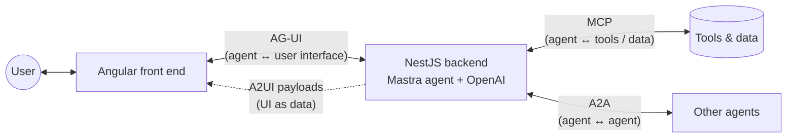

# Step 0 — Agentic UI: concepts, families and constraints

> Goal of this step: build a shared vocabulary before writing any code.
> Everything here will be made concrete in Steps 1–8.

---

## 1. What is an "agentic UI"?

A classic UI is **request/response**: the user clicks, the app calls an API, the UI renders the result.
The UI fully owns *what* is displayed and *when*.

An **agentic UI** is the front end of an application where an **agent** (an LLM in a loop that can
reason, call tools and keep state) is a first-class actor:

- the agent produces output **progressively** (streaming), over seconds or minutes;
- it **acts**: it calls tools, some on the server, some in the browser;
- it **changes state** that the user also sees and edits;
- it sometimes needs the **user's decision** before continuing;
- it can **decide what UI to show**, not only what text to say.

The UI is no longer a passive renderer of API responses; it is a **collaboration surface**
between a human and an agent. This raises a protocol question: *how do agent and UI talk?*
That is exactly what AG-UI standardizes.

---

## 2. Interaction patterns

| Pattern | Description | Example in our running app |
|---|---|---|
| **Chat** | Conversation is the main surface. | "What's the status of INC-1042?" |
| **Copilot / embedded assistant** | The agent lives *inside* an existing app (sidebar, inline), reads and acts on its context. | The assistant sees the incident board currently on screen. |
| **Background / ambient agent** | Runs without a conversation, surfaces results or notifications. | An agent triaging new incidents overnight. |
| **Human-in-the-loop (HITL)** | The agent pauses and asks the user to approve, edit or reject. | "Restart service `payments-api`?" → Approve / Reject. |
| **Shared state / co-editing** | Agent and user manipulate the same structured state. | Both update priorities on the incident board. |
| **Frontend tools** | The agent invokes functions that run **in the browser** (navigate, fill a form, highlight). | "Open incident INC-1042" → the UI routes to it. |

These patterns combine: a real app is usually a copilot + HITL + shared state.

---

## 3. Generative UI: three families

"Generative UI" means the **agent influences what UI is rendered**, not just text.
There is a spectrum, trading **control** for **flexibility**:

```
 more control, less freedom                                   more freedom, less control
 ───────────────────────────────────────────────────────────────────────────────────────►
   STATIC                         DECLARATIVE                         OPEN-ENDED
   (predefined components)        (A2UI: UI described as data)        (agent-generated HTML / iframes)
```

### 3.1 Static generative UI

The developer builds a fixed set of components. The agent **chooses** which one to show and
**fills its data**, typically through a tool call (`show_incident_card({ id, title, severity })`).

- ✅ Pixel-perfect, on-brand, accessible, testable, secure (no foreign code).
- ✅ Simple mental model: tool name → component.
- ❌ Every new UI need = new component + new tool + redeploy.
- ❌ The agent cannot compose new layouts.
- 👉 Our **Step 3**.

### 3.2 Declarative generative UI (A2UI)

The agent emits a **description of the UI as data** (JSON): which components, in which layout,
bound to which data. The client renders it **with its own native components** (here: Angular)
taken from a **catalog** it trusts.

- ✅ The agent can compose new screens (forms, dashboards) without new front-end code.
- ✅ Still safe: data, not code. The client only renders components it knows.
- ✅ Framework-agnostic: the same payload can be rendered by Angular, Lit, Flutter...
- ❌ Expressiveness limited by the catalog.
- ❌ LLM must produce valid, well-structured JSON → validation, retries, prompting effort.
- ❌ Harder to guarantee UX quality and consistency.
- 👉 Our **Step 7**.

### 3.3 Open-ended generative UI

The agent (or a tool server) returns **arbitrary UI**: HTML/JS, usually sandboxed in an iframe
(e.g. MCP Apps style).

- ✅ Maximum freedom; UI can be shipped by a third party with its tool.
- ❌ Security (sandboxing, CSP, data exfiltration), look & feel inconsistency,
  accessibility, theming, communication between iframe and host.
- 👉 Discussed only, not implemented in this journey.

### Summary

| | Static | Declarative (A2UI) | Open-ended |
|---|---|---|---|
| Who owns the components | Front-end team | Front-end team (catalog) | Agent / tool provider |
| Who owns the layout | Front-end team | Agent | Agent / tool provider |
| What travels on the wire | Tool call + args | JSON UI description + data | HTML/JS (or URL) |
| Security risk | Low | Low | High |
| Brand consistency | High | Medium–high | Low |
| Flexibility | Low | Medium–high | Very high |

---

## 4. Cross-cutting constraints

Whatever the family, an agentic UI must deal with:

1. **Latency & streaming** — answers take seconds. Show progress token by token, show
   "thinking" / tool activity, allow **cancellation**.
2. **Partial data** — tool arguments arrive as JSON *fragments*; a component may need to render
   before its data is complete (or wait).
3. **State synchronization** — who is the source of truth? How to merge agent and user edits?
   (AG-UI answers with snapshots + JSON Patch deltas.)
4. **Interruption & resumption** — HITL means a run can pause, wait for a human,
   and resume, possibly much later.
5. **Security** — never execute agent output as code; validate every payload;
   treat the LLM as untrusted input; protect secrets (the API key stays server-side).
6. **Non-determinism** — the same prompt can produce different outputs: UIs must be robust
   to unexpected shapes; tests rely on **recorded/mocked event streams** (our mock server).
7. **Error handling & resilience** — network drops, LLM errors, malformed events,
   reconnection, idempotency.
8. **UX & trust** — make the agent's actions visible and reversible; ask before acting
   on anything destructive.
9. **Cost & rate limits** — each run costs tokens; avoid unnecessary calls.
10. **Accessibility & design system** — generated UIs must still respect a11y and the brand.

---

## 5. The protocol landscape

Several open protocols appeared, each for a different edge of the system:



| Protocol | Connects | Purpose |
|---|---|---|
| **MCP** (Model Context Protocol) | Agent ↔ tools / data sources | Give agents access to tools and context. |
| **A2A** (Agent-to-Agent) | Agent ↔ agent | Delegation and collaboration between agents. |
| **AG-UI** (Agent–User Interaction) | Agent ↔ front end | Bi-directional, event-based runtime connection: streaming text, tool calls, state, lifecycle. |
| **A2UI** (Agent-to-User Interface) | Agent → UI renderer | A **format** describing UI declaratively. It is a *payload*, carried by a transport such as AG-UI or A2A. |

Key point: **AG-UI and A2UI are complementary, not competitors.** AG-UI is the transport and
the interaction model; A2UI is one way to describe *what to render*.

---

## 6. AG-UI in a nutshell

### 6.1 Model

1. The front end starts a **run** by sending a `RunAgentInput` (HTTP POST):
   `threadId`, `runId`, `messages`, `tools` (frontend tools), `state`, `context`, `forwardedProps`.
2. The agent answers with a **stream of typed events** (typically Server-Sent Events).
3. The client folds those events into its UI state: messages, tool calls, shared state.

AG-UI is **transport-agnostic** and **framework-agnostic**: any backend (Mastra, LangGraph,
Pydantic AI, a hand-written NestJS endpoint...) that emits these events is compatible with any
AG-UI client. Our NestJS server makes this explicit: the same endpoint serves either a mock runner
or a Mastra runner.

### 6.2 Event families

| Family | Events | Used in |
|---|---|---|
| Lifecycle | `RUN_STARTED`, `RUN_FINISHED`, `RUN_ERROR`, `STEP_STARTED`, `STEP_FINISHED` | Step 1 |
| Text messages | `TEXT_MESSAGE_START`, `TEXT_MESSAGE_CONTENT`, `TEXT_MESSAGE_END` | Steps 1–2 |
| Tool calls | `TOOL_CALL_START`, `TOOL_CALL_ARGS`, `TOOL_CALL_END`, `TOOL_CALL_RESULT` | Step 3 |
| State | `STATE_SNAPSHOT`, `STATE_DELTA` (JSON Patch, RFC 6902), `MESSAGES_SNAPSHOT` | Step 4 |
| Special | `RAW`, `CUSTOM` | Steps 5, 7 |

(Newer versions of the protocol add more events, e.g. for reasoning or chunked messages;
we will pin package versions in Step 1 and stick to them.)

A minimal run looks like:

```text
RUN_STARTED          { threadId, runId }
TEXT_MESSAGE_START   { messageId, role: "assistant" }
TEXT_MESSAGE_CONTENT { messageId, delta: "INC-1042 is " }
TEXT_MESSAGE_CONTENT { messageId, delta: "currently open." }
TEXT_MESSAGE_END     { messageId }
RUN_FINISHED         { threadId, runId }
```

---

## 7. A2UI in a nutshell

- The agent sends **JSON messages** that describe a **surface** (a region of UI):
  - a set of **components** with ids, types from the catalog (`Text`, `Button`, `TextField`,
    `Card`, `Row`, `Column`, `List`...) and properties;
  - a **data model**, and **bindings** from component properties to paths in that model;
  - a signal to **begin rendering**, and later incremental **updates**.
- Components are described as a **flat list referencing children by id** (not a deep tree):
  this is easy for an LLM to generate and easy to stream/patch incrementally.
- User interactions (button click, form submit) are sent back to the agent as **actions/events**.
- The client renderer maps each catalog type to a **native component** — for us, Angular
  components styled with our design system.

The exact message names have evolved between spec versions; we will pin a version in Step 7.

---

## 8. Mapping concepts to the journey

| Concept | Step |
|---|---|
| AG-UI event stream, lifecycle | 1 |
| Streaming text, cancellation | 2 |
| Static generative UI, frontend tools | 3 |
| Shared state (snapshot + JSON Patch) | 4 |
| Human-in-the-loop | 5 |
| Framework-agnostic backend (NestJS provider swap: mock → Mastra) | 6 |
| Declarative generative UI (A2UI) | 7 |
| Production concerns, CopilotKit comparison | 8 |

---

## Glossary

- **Agent** — an LLM running in a loop with instructions, tools and memory.
- **Run** — one execution of the agent in response to an input; identified by `runId`.
- **Thread** — a conversation spanning several runs; identified by `threadId`.
- **Tool call** — the agent requesting a function execution with JSON arguments.
- **Frontend tool** — a tool declared by the UI and executed in the browser.
- **Surface** (A2UI) — a region of UI controlled by the agent.
- **Catalog** (A2UI) — the set of component types a client agrees to render.
- **JSON Patch** — RFC 6902 format to express incremental changes to a JSON document.

## References

- AG-UI documentation — https://docs.ag-ui.com
- AG-UI repository — https://github.com/ag-ui-protocol/ag-ui
- A2UI repository — https://github.com/google/A2UI
- Mastra — https://mastra.ai
- CopilotKit for Angular — https://docs.copilotkit.ai/reference/angular
